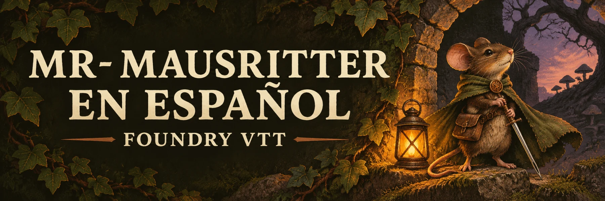

<p align="center">
  
</p>

<p align="center">
  <a href="https://github.com/ManuRomera"></a>
  <a href="https://github.com/ManuRomera/mr-mausritter-es/releases/latest"></a>
  
  <a href="https://github.com/ManuRomera/mr-mausritter-es/releases"></a>
  <a href="LICENSE"></a>
</p>

<h3 align="center">Mausritter en español de España para Foundry VTT, con equipo ilustrado, combate automatizado y herramientas de accesibilidad.<br>Una aguja por espada, toda la mesa lista para jugar.</h3>

---

## ⚡ Instalación en 10 segundos

Necesitas **Foundry VTT v13** y el sistema **Mausritter 0.6.1**. En Foundry, abre **Add-on Modules → Install Module → Manifest URL** y pega:

```
https://github.com/ManuRomera/mr-mausritter-es/releases/latest/download/module.json
```

Activa **MR- Mausritter en español** en tu mundo y selecciona **Español** en la configuración. Activa **Babele** si quieres localizar también los compendios base. Si venías usando **Mausritter Damage Helper**, desactívalo para pasar a la automatización integrada.

## 📦 Qué trae

| | |
|---|---|
| 🖥️ **Mausritter en español** | Controles, etiquetas y trasfondos con castellano ampliado. |
| 📚 **Compendios base** | Con Babele se localizan 110 entradas de armas, armaduras, equipo, condiciones y hechizos. Las descripciones de los hechizos se cargan desde el sistema. |
| 🧰 **Equipo de aventura** | 32 objetos y condiciones de **Reservoir Mice** y 48 de **Requesón en Waterdeep**, con 41 ilustraciones. Consulta también los objetos que tienes disponibles en el mundo y en los compendios. |
| ⚔️ **Combate automatizado** | Aplica daño a los objetivos del chat, calcula armadura, PG y FUE, y resuelve salvaciones críticas. Gasto automático de usos configurable. |
| ♿ **Mesa** | Modo oscuro, alto contraste, texto ampliable, fuente legible, movimiento reducido, ayuda contextual, cabecera solo con iconos y **ficha resumida**. |
| 🎒 **Inventario en lista** | Busca, consulta y usa el equipo. Cambia el dado de daño, ajusta usos y asigna huecos sin arrastrar. |

## ⚔️ Combate en dos clics

Marca uno o varios tokens como objetivo y pulsa **Aplicar daño** en la tarjeta de un arma. La armadura absorbe primero, luego se descuentan PG y, si sobran puntos de daño, FUE. Si FUE recibe daño, en esa misma tarjeta puedes lanzar la salvación normal, con ventaja o con desventaja. Si falla, la resolución automática añade **Herido**. **Agallas** y el **gasto automático de usos** son opciones del mundo.

El DJ activo gestiona el daño de las tiradas que puede ver. Cuando no hay DJ disponible, el autor puede aplicar sus propias tiradas a las fichas que puede editar.

## ♿ Mesa, ficha resumida e inventario

Abre un personaje y pulsa el icono de **Accesibilidad** (♿, junto a Cerrar en la cabecera) para elegir los ajustes de lectura de tu cliente. El icono de **Ficha resumida** compacta la propia hoja: FUE, DES, VOL, PG, Pepitas y Agallas en una franja y el inventario a la vista, con el mismo estilo en claro y oscuro y todo editable y tirable. Vuelve a pulsarlo para ver la ficha completa. Desde **Inventario en lista** puedes usar o mover objetos con el teclado y abrir su ficha completa.

**Catálogo de objetos** muestra los documentos a los que tienes acceso. El DJ puede consultar los dos paquetes de aventura incluidos y los objetos disponibles de **La Tumba de las Mil Puertas** y **Aventuras en La Finca** si los tiene en el mundo.

## 🔧 Cómo está hecho

- `lang/` y `compendium/`: localización de interfaz y traducciones para Babele.
- `scripts/main.mjs`, `scripts/inventory.mjs` y `scripts/catalog.mjs`: ajustes, inventario, accesibilidad y catálogo.
- `scripts/combat.mjs`: daño, salvaciones críticas y usos, a partir de Mausritter Damage Helper.
- `packs/` y `assets/`: compendios e ilustraciones de equipo.

## 📄 Licencia y créditos

**MR- Mausritter en español** is an independent production by Manu Romera and is not affiliated with Losing Games. It is published under the [Mausritter Third Party Licence](https://mausritter.com/third-party-licence/). Mausritter is copyright Losing Games.

Código bajo [licencia MIT](LICENSE). Consulta los [créditos y licencias](NOTICE.md) y el [historial de cambios](CHANGELOG.md).

---

<p align="center">
  <a href="https://github.com/ManuRomera">
    <picture>
      <source media="(prefers-color-scheme: dark)" srcset="https://raw.githubusercontent.com/ManuRomera/ManuRomera/main/brand/MR_09_Monograma_Marfil_Transparente.png">
      
    </picture>
  </a><br>
  <sub>Hecho por <a href="https://github.com/ManuRomera"><b>Manu Romera</b></a> · Digital RPG Design</sub>
</p>
